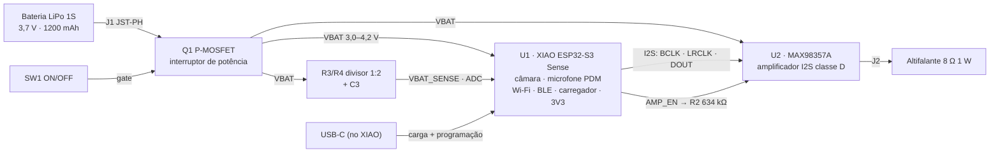
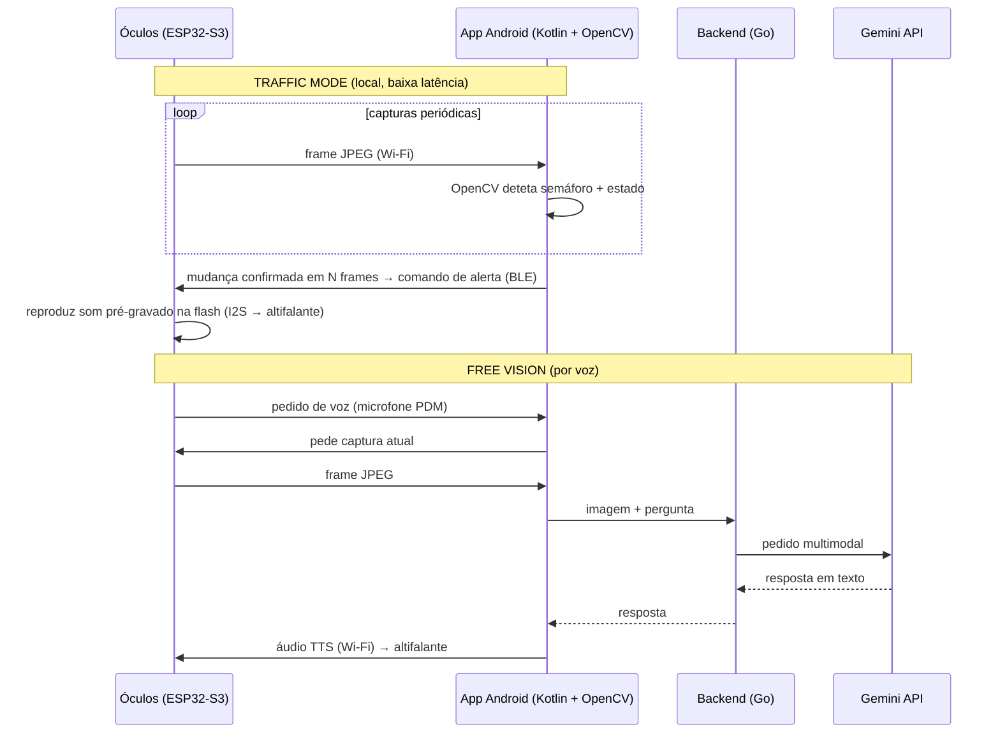

# PIXEL — Documentação de Hardware

**Revisão:** 0.1 · **Data:** 22/11/2026 · **Estado:** protótipo conceptual (desenhado e verificado em KiCad; ainda não fabricado nem testado fisicamente)

Legenda usada neste documento:

| Marca | Significado |
|---|---|
| ✅ **Confirmado** | Verificado em datasheet, esquema oficial ou documentação do fabricante |
| 🟡 **Proposta** | Decisão de projeto fundamentada, mas que precisa de validação física |
| ❓ **A confirmar** | Informação que não foi possível verificar (preço, polaridade, etc.) |

> ⚠️ **Aviso de segurança.** O PIXEL é um protótipo experimental de assistência. **Não é um sistema certificado de segurança rodoviária** e não decide se o utilizador pode atravessar. A deteção de semáforos pode falhar; o utilizador deve continuar a observar o ambiente e a sinalização.

---

## A. Introdução — arquitetura eletrónica

O PIXEL é um pequeno módulo destacável para óculos. A eletrónica foi deliberadamente reduzida ao mínimo: quase toda a "inteligência" (visão computacional, IA, voz) corre no telemóvel e no backend. O hardware só tem de **capturar imagem e som, comunicar e reproduzir áudio**.



**Componentes principais**

| Bloco | Solução | Estado |
|---|---|---|
| Unidade principal | **Seeed Studio XIAO ESP32-S3 Sense** (ESP32-S3R8, 8 MB PSRAM + 8 MB flash, Wi-Fi 2,4 GHz + BLE 5) | ✅ escolhido no briefing, mantido |
| Câmara | Incluída no Sense — **OV5640** (lotes recentes; podem vir com **OV3660**). O OV2640 foi descontinuado | ✅ (wiki Seeed) |
| Microfone | **Microfone digital PDM já integrado** no Sense (CLK GPIO42, DATA GPIO41). **Não é preciso microfone externo** | ✅ |
| Amplificador | **MAX98357A** (I2S → classe D, sem MCLK, 2,5–5,5 V) | ✅ validado pelo datasheet |
| Altifalante | Micro-altifalante LOUDITY LD-SP-U15.5/8A: 8 Ω, 1 W (1,2 W máx.), Ø16 × 3,5 mm, com fios | ✅ (dados TME) |
| Alimentação | LiPo 1S EasyLander 1200 mAh + interruptor (protótipo: em série; PCB final: **P-MOSFET** DMG2305UX comandado por SW1) | 🟡 |
| Carregamento | Carregador **já integrado no XIAO** (SGM40567, ≈110 mA) via USB-C | ✅ (esquema oficial Seeed) |
| Medição de bateria | Divisor 1:2 (2 × 100 kΩ) para o ADC (o XIAO S3 não tem medição interna) | ✅ |

**Quatro projetos KiCad**

| Variante | Pasta | O que mostra | Imagens |
|---|---|---|---|
| **Protótipo** — layout final | `hardware/kicad/PIXEL_PROTO/` | Montagem real: meia placa perfurada 35 × 50 mm (12 × 17 furos); em cima XIAO, módulo, interruptor e fios da bateria; **em baixo o divisor R1/R2 e a bateria**; altifalante preso pelos fios | `renders/PIXEL_PROTO_FINAL_TOP.png`, `PIXEL_PROTO_FINAL_BOTTOM.png`, `PIXEL_PROTO_3D.png`, `PIXEL_PROTO_BOTTOM.png` |
| **Protótipo** — vista de ligações | `hardware/kicad/PIXEL_PROTO_DEV/` | Mesmo esquema do protótipo, espaçado em 70 × 50 mm para explicar cada fio | `renders/PIXEL_PROTO_LAYOUT.png` |
| **PCB final** — layout (vista superior) | `hardware/kicad/PIXEL_DEV/` | Mesmo esquema da PCB final, espaçado em blocos com pistas visíveis | `renders/PIXEL_COMPONENT_LAYOUT.png` |
| **PCB final** — montagem 3D | `hardware/kicad/PIXEL/` | PCB final 54 × 24 × 1,0 mm para a haste dos óculos | `renders/PIXEL_FINAL_PCB_3D.png` |

`PIXEL` e `PIXEL_DEV` partilham o mesmo esquema; `PIXEL_PROTO` e `PIXEL_PROTO_DEV` partilham o esquema do protótipo (módulos prontos). A paridade esquema ↔ PCB foi verificada pelo DRC do KiCad nos quatro (ver secção H).

---

## B. Lista de componentes (BOM)

Ficheiro completo (com códigos de fornecedor e notas): [`PIXEL_BOM.csv`](PIXEL_BOM.csv).

O projeto tem **duas variantes de hardware** com o mesmo funcionamento:

- **Protótipo** — para apresentar já: só as peças iniciais (XIAO Sense, bateria, **módulo** MAX98357A, altifalante, interruptor) **+ duas resistências** para medir a % da bateria, montados com fios em meia placa perfurada (35 × 50 mm).
- **PCB final** — versão compacta para a haste dos óculos, com o chip MAX98357A soldado na placa e um interruptor por P-MOSFET.

**Como foram obtidos os preços:** os sites da Mouser e da Farnell bloqueiam pedidos automáticos; os preços foram lidos nas **páginas de produto indexadas das lojas europeias em EUR** (Farnell IE/ES/DE, Mouser EU/DE) a **22/11/2026**, **sem IVA e sem portes**. A bateria (9,15 €) e os preços da **Mauser** para o protótipo (módulo 4,18 €, altifalante 2,09 €, interruptor 2,10 €, placa 0,95 € — **com IVA**) são preços indicados pelo aluno; o módulo estava **esgotado** na Mauser a 22/11/2026 (alternativa: Adafruit 3006, 5,12 € s/ IVA na Mouser); as resistências foram consideradas a 0,10 €/un. Confirmar sempre no carrinho antes de encomendar.

### B1. Protótipo (placa perfurada)

| Componente | Fabricante | Referência | Qtd | Preço unitário | Subtotal | Fonte |
|---|---|---|---|---|---|---|
| U1 · XIAO ESP32-S3 Sense | Seeed Studio | 113991115 | 1 | 12,06 € | 12,06 € | [Farnell 4200197](https://ie.farnell.com/seeed-studio/113991115/development-board-32bit-xtensa/dp/4200197) |
| BT1 · LiPo 3,7 V 1200 mAh (40×30×10 mm) | EasyLander | 103040 | 1 | 9,15 € | 9,15 € | preço indicado |
| A1 · Módulo amplificador I2S MAX98357A (formato Adafruit 3006) | genérico | MAX98357A I2S | 1 | 4,18 € | 4,18 € | Mauser 094-0329 (esgotado) |
| LS1 · Altifalante 8 Ω 1 W Ø16 × 3,5 mm | LOUDITY | LD-SP-U15.5/8A | 1 | 2,09 € | 2,09 € | Mauser 091-0753 · [dados TME](https://www.tme.eu/en/details/ld-sp-u15.5_8a/speakers/loudity/) |
| SW1 · Interruptor deslizante SPDT ON-ON 0,5 A / 12 V | ECE | ESP1010 | 1 | 2,10 € | 2,10 € | Mauser 010-6634 · [dados TME](https://www.tme.eu/en/details/esp1010/slide-switches/ece/) |
| R1, R2 · 100 kΩ 1 % axial (divisor de tensão da bateria) | — | — | 2 | 0,10 € | 0,20 € | — |
| Placa perfurada 50×70 mm, 17×24 furos (usa-se metade) | — | — | 1 | 0,95 € | 0,95 € | Mauser 096-6400 |
| Barras de pinos, fio, estanho, fita dupla face | — | — | — | **Indefinido** | — | laboratório |
| **Total do protótipo** | | | | | **30,73 €** | + consumíveis |

### B2. PCB final

| Componente | Fabricante | Referência | Qtd | Preço unitário | Subtotal | Fonte |
|---|---|---|---|---|---|---|
| U1 · XIAO ESP32-S3 Sense | Seeed Studio | 113991115 | 1 | 12,06 € | 12,06 € | Farnell 4200197 |
| BT1 · LiPo 3,7 V 1200 mAh | EasyLander | 103040 | 1 | 9,15 € | 9,15 € | preço indicado |
| U2 · MAX98357AETE+T (TQFN-16) | Analog Devices | MAX98357AETE+T | 1 | 3,21 € | 3,21 € | [Mouser](https://www.mouser.com/ProductDetail/Analog-Devices-Maxim-Integrated/MAX98357AETE+T?qs=AAveGqk956HhNpoJjF5x2g%3D%3D) |
| LS1 · Altifalante 8 Ω 1 W Ø16 mm | LOUDITY | LD-SP-U15.5/8A | 1 | 2,09 € | 2,09 € | Mauser 091-0753 |
| SW1 · Interruptor SPDT SMD | C&K | PCM12SMTR | 1 | 0,993 € | 0,99 € | [Farnell 9575146](https://ie.farnell.com/c-k-components/pcm12smtr/switch-spdt-0-3a-6vdc-smd/dp/9575146) |
| Q1 · P-MOSFET SOT-23 | Diodes Inc. | DMG2305UX-7 | 1 | 0,333 € | 0,33 € | Mouser |
| J1 · JST-PH 2 vias | JST | S2B-PH-K-S(LF)(SN) | 1 | 0,0841 € *(lotes de 100)* | 0,08 € | [Farnell 9491902](https://es.farnell.com/jst-japan-solderless-terminals/s2b-ph-k-s-lf-sn/conector-macho-tht-r-a-2-mm-2/dp/9491902) |
| C1 · 10 µF 0603 | Murata | GRM188R61A106KE69D | 1 | 0,162 € | 0,16 € | Mouser |
| C2, C3 · 100 nF 0603 | YAGEO | CC0603KRX7R7BB104 | 2 | 0,087 € | 0,17 € | Mouser |
| R1, R3, R4 · 100 kΩ 0603 | YAGEO | RC0603FR-07100KL | 3 | 0,10 € | 0,30 € | Mouser |
| R2 · 634 kΩ 0603 | YAGEO | RC0603FR-07634KL | 1 | 0,10 € | 0,10 € | Mouser |
| PCB (2 camadas, 54×24 mm) | — | Gerbers em `kicad/PIXEL/fabrication` | 1 | **Indefinido** | — | — |
| Envio / portes | — | — | — | **Indefinido** | — | — |
| **Total da PCB final (componentes com preço)** | | | | | **28,66 €** | + PCB + envio |

### Resumo do orçamento

| Rubrica | Protótipo | PCB final |
|---|---|---|
| Componentes com preço | **30,73 €** | **28,66 €** |
| Indefinido | consumíveis (fio, estanho, pinos) | fabrico da PCB e envio |
| Montagem | manual, com ferro de soldar (sem SMD) | exige pasta de solda + ar quente (TQFN) ou serviço PCBA |

O XIAO ESP32-S3 Sense (12,06 €) e a bateria (9,15 €) representam ≈ 74 % do custo.

---

## C. Ligações elétricas

### C1. Protótipo (fios na placa perfurada)

**Porque é que o divisor tem duas resistências?** Um divisor de tensão precisa sempre de **duas** resistências em série: a tensão divide-se na proporção entre elas. Com R1 = R2 = 100 kΩ entre VBAT e GND, o ponto do meio fica com **metade** da tensão da bateria (4,2 V → 2,1 V; 3,0 V → 1,5 V), dentro da gama que o ADC do ESP32-S3 consegue medir. Uma resistência sozinha não dividia nada — o pino ficava com a tensão toda da bateria (até 4,2 V, acima dos 3,3 V permitidos). Com 200 kΩ no total, o divisor gasta só ≈ 20 µA.

**Disposição (PIXEL_PROTO):** em cima, o XIAO (USB-C virado para a borda) e, logo abaixo, o módulo amplificador — os pinos D2/D3/D4 ficam alinhados com DIN/BCLK/LRC, por isso os três fios I2S são curtos e retos; no canto, o interruptor ESP1010 e os fios da bateria (J1). Em baixo, R1/R2 e a bateria, colada com fita dupla face. O altifalante fica preso pelos fios (no PIXEL vai junto ao ouvido).


| De | Para | Função |
|---|---|---|
| Bateria **+** (vermelho) | SW1 comum | Entrada do interruptor |
| SW1 (posição ON) | pad **BAT+** do XIAO (face inferior) + **Vin** do módulo + R1 | VBAT (3,0–4,2 V) |
| Bateria **−** (preto) | pad **BAT−** do XIAO + **GND** do módulo + R2 | Massa comum |
| XIAO **D2** (GPIO3) | módulo **DIN** | Dados de áudio I2S |
| XIAO **D3** (GPIO4) | módulo **BCLK** | Relógio de bit I2S |
| XIAO **D4** (GPIO5) | módulo **LRC** | Relógio de trama I2S |
| XIAO **D0** (GPIO1) | ponto médio R1/R2 | Leitura da bateria (ADC) → % na app |
| Borne **+ / −** do módulo | altifalante | Saída de áudio |
| Módulo **SD**, **GAIN** | — (como vêm) | Mono (L+R)/2 · 9 dB |

O pad **BAT−** do XIAO fica do lado do USB (Seeed). A ordem física dos pinos do módulo (formato Adafruit 3006) não é publicada: **confirmar na serigrafia do módulo** antes de soldar. O mapa de pinos é o mesmo da PCB final, por isso o firmware serve para as duas versões.

### C2. PCB final

### Tabela de ligações

| Componente | Pino | Ligação (rede) | Função |
|---|---|---|---|
| U1 XIAO | D0 / GPIO1 (pad 1) | VBAT_SENSE | ADC1_CH0 — leitura da tensão da bateria (divisor 1:2) |
| U1 XIAO | D1 / GPIO2 (pad 2) | AMP_EN → R2 → U2.4 | Liga/desliga o amplificador |
| U1 XIAO | D2 / GPIO3 (pad 3) | I2S_DOUT → U2.1 (DIN) | Dados de áudio I2S |
| U1 XIAO | D3 / GPIO4 (pad 4) | I2S_BCLK → U2.16 (BCLK) | Relógio de bit I2S |
| U1 XIAO | D4 / GPIO5 (pad 5) | I2S_LRCLK → U2.14 (LRCLK) | Relógio de trama I2S |
| U1 XIAO | BAT+ (pad inferior 23) | VBAT | Entrada de bateria do XIAO (carregador + power path) |
| U1 XIAO | GND (pads 13, 18, 24) | GND | Massa |
| U1 XIAO | D5–D10, 3V3, 5V, EN, JTAG, USB | — | Sem ligação (ver reservas abaixo) |
| U2 MAX98357A | 7, 8 (VDD) | VBAT + C1 10 µF + C2 100 nF | Alimentação 3,0–4,2 V |
| U2 MAX98357A | 3, 11, 15, EP | GND | Massa + dissipação (EP com vias térmicas) |
| U2 MAX98357A | 4 (SD_MODE) | AMP_SD ← R2 634 kΩ ← AMP_EN | Shutdown / seleção de canal |
| U2 MAX98357A | 2 (GAIN_SLOT) | — | Em aberto → ganho de 9 dB |
| U2 MAX98357A | 9 (OUTP) / 10 (OUTN) | SPK_P / SPK_N → J2 | Saída em ponte para o altifalante |
| Q1 DMG2305UX | 2 (S) | BAT+ | Fonte ligada à bateria |
| Q1 DMG2305UX | 3 (D) | VBAT | Saída comutada para o sistema |
| Q1 DMG2305UX | 1 (G) | PWR_CTRL | Gate comandada por SW1 |
| R1 100 kΩ | — | BAT+ ↔ PWR_CTRL | Mantém Q1 desligado durante a comutação |
| SW1 PCM12 | 2 (comum) | PWR_CTRL | — |
| SW1 PCM12 | 1 / 3 | GND (posição ON) / BAT+ (posição OFF) | Liga a gate a GND (ON) ou à fonte (OFF) |
| J1 JST-PH | 1 / 2 | BAT+ / GND | Ficha da bateria (**polaridade a confirmar** ❓) |
| R3 / R4 100 kΩ | — | VBAT → VBAT_SENSE → GND | Divisor 1:2 |
| C3 100 nF | — | VBAT_SENSE ↔ GND | Estabiliza a amostragem do ADC |
| J2 | 1 / 2 | SPK_P / SPK_N | Pontos de soldadura dos fios do altifalante |

### Pinos ocupados pelo próprio XIAO ESP32-S3 Sense (não passam pela PCB PIXEL) ✅

| Periférico | GPIO |
|---|---|
| Câmara (DVP) | XCLK 10 · SIOD 40 · SIOC 39 · VSYNC 38 · HREF 47 · PCLK 13 · Y2–Y9 = 15, 17, 18, 16, 14, 12, 11, 48 |
| Microfone PDM | CLK 42 · DATA 41 (pinos D11/D12 reservados ao microfone por omissão; jumper J1/J2) |
| microSD | CS 21 · SCK 7 (D8) · MISO 8 (D9) · MOSI 9 (D10) → **D8–D10 reservados** |
| UART0 / USB | D6/GPIO43 (TX), D7/GPIO44 (RX) livres; a consola usa o USB nativo |

**Conflitos verificados:**
- **I2S:** o ESP32-S3 tem dois periféricos I2S. O **I2S0** fica para o microfone (o modo PDM-RX só existe no I2S0) e o **I2S1** para o amplificador (TX standard), por isso não há conflito.
- **GPIO3 (D2)** é pino de *strapping* (fonte do JTAG), mas só tem efeito se o eFuse correspondente estiver ativo. Por omissão é ignorado, e como liga a uma entrada de alta impedância (DIN) não força nenhum nível no arranque.
- **Ordem dos pinos:** D1–D4 foram atribuídos pela ordem física dos pads do XIAO e dos pinos do MAX98357A. Assim as pistas da PCB final ficam **paralelas e sem cruzamentos**, numa só camada; o roteamento interno de GPIO do ESP32-S3 permite qualquer atribuição.

### Alimentação e GND
Ver secção D. A massa é um plano contínuo nas duas faces da PCB final (camada inferior no modelo de desenvolvimento), com vias de costura. O pad exposto do MAX98357A tem 4 vias térmicas para o plano inferior.

### Amplificador e altifalante ✅
- **VDD = VBAT** (3,0–4,2 V), dentro dos 2,5–5,5 V do datasheet, com 10 µF + 100 nF junto ao CI ("Bypass VDD with a 0.1 µF and 10 µF capacitor").
- **SD_MODE:** com a GPIO a 3,3 V e R2 = 634 kΩ, o divisor com o pull-down interno de 100 kΩ dá **V = 3,3 × 100 / 734 ≈ 0,45 V** (0,41–0,48 V com a tolerância de ±8 % do RPD). Este valor fica entre os limiares B0 = 0,16 V e B1 = 0,77 V, o que seleciona **(L + R)/2 — mono**. Com a GPIO a 0 V entra em **shutdown (0,6 µA)**. É o valor R_LARGE da Tabela 6 do datasheet. A resistência em série também evita a situação que o datasheet descreve quando VDD < VDDIO, com a bateria quase descarregada.
- **Potência:** 0,77 W em 8 Ω com VDD = 3,7 V (THD+N 1 %). O altifalante LD-SP-U15.5/8A aguenta 1 W nominal (1,2 W máx.), acima dos 0,77 W; mesmo assim, o firmware deve **limitar o volume digital**, porque o som fica junto ao ouvido. Em funcionamento normal (voz e alertas) a potência média é muito inferior.
- Saída *filterless*: o altifalante tem de ter indutância > 10 µH (os altifalantes de 8 Ω típicos têm 20–100 µH). ❓ confirmar com a ficha do LD-SP-U15.5/8A.

### Microfone ✅
O Sense já tem um **microfone digital PDM** (16 kHz mono é o modo estável indicado pela Seeed). **Não se compra nem se adiciona microfone externo.**

### Câmara ✅ / 🟡
A câmara (OV5640 ou OV3660, conforme o lote) liga ao Sense por um **cabo FPC de 24 pinos** (conector AFC01-S24 visível no modelo 3D oficial). O Sense liga ao XIAO por um conector B2B Hirose DF40 de 30 pinos. **A câmara não está montada na PCB PIXEL.** No produto final, o FPC pode ser dobrado 90° para a câmara ficar virada para a frente, na extremidade do módulo (🟡 a validar mecanicamente).

### Interruptor 🟡
Os micro-interruptores deslizantes SMD encontrados estão especificados para ≤ 0,3 A, mas o sistema pode ter picos de ≈ 0,4–0,6 A (366 mA medidos pela Seeed na captura de imagem, mais o amplificador). Por isso **o SW1 não transporta a corrente**: apenas liga a gate do Q1 (corrente de µA). O Q1 (até 4,2 A, R_DS(on) ≤ 100 mΩ a −2,5 V) é o verdadeiro interruptor de potência.

---

## D. Arquitetura de alimentação

```
LiPo 3,0–4,2 V ── J1 ── Q1 (P-MOSFET) ──┬── XIAO pad BAT+ ──► power path interno ──► buck SGM6029 ──► 3V3 (ESP32-S3, câmara, mic)
     (BAT+)              ▲ gate          ├── MAX98357A VDD (direto)
                         │               └── divisor R3/R4 → ADC
                SW1 (GND = ON / BAT+ = OFF) + R1 100 kΩ
USB-C (no XIAO) ──► carregador SGM40567 (4,2 V, ≈110 mA) ──► pad BAT+
```

**Porque é que a bateria não liga "a qualquer pino":**

- O XIAO tem pads próprios de bateria (BAT+/BAT−, na face inferior). No esquema oficial Seeed v1.2, esses pads ligam ao **carregador SGM40567** (I_carga = 24 000 / 220 kΩ ≈ **110 mA**) e a um *power path* com P-MOSFET. Quando há USB, o sistema é alimentado pelo USB através de um díodo Schottky e a bateria carrega.
- O pino **5V é o VBUS do USB**: com bateria não tem tensão (confirmado pela Seeed). Por isso o amplificador **não** pode ser alimentado pelo pino 5V.
- O regulador **3V3 (SGM6029)** tem o limite de **600 mA** anotado no esquema oficial (a wiki indica 700 mA). Esse limite é partilhado com o ESP32-S3, que tem picos de Wi-Fi. Por isso o amplificador é alimentado **diretamente por VBAT**: os picos de áudio não passam pelo regulador.

**Interruptor por P-MOSFET (Q1 = DMG2305UX):** ✅ datasheet Diodes Inc.
- ON: SW1 liga a gate a GND, logo V_GS = −V_BAT (−3,0 a −4,2 V), bem acima do V_GS(th) máximo (−0,9 V). Com R_DS(on) ≤ 100 mΩ a −2,5 V, a queda a 0,5 A é ≤ 50 mV. V_GS máximo = ±8 V ✅.
- OFF: SW1 liga a gate à fonte, Q1 corta e o sistema fica a 0 µA. **Porque é que não basta o deep-sleep:** o Sense consome **3 mA em deep-sleep** (valor da Seeed), o que esgotaria 1200 mAh em cerca de 16 dias.
- **Limitação:** com o interruptor em OFF e o USB ligado, o díodo intrínseco do Q1 deixa passar uma carga parcial e não controlada (até ≈ 4,2 V − 0,6 V). **Recomendação: carregar sempre com o interruptor em ON.** O firmware deve manter o amplificador em shutdown durante a carga.

**Carregamento e proteção:**
- Tempo de carga estimado: 1200 mAh / 110 mA ≈ **11 h** (corrente de carga fixa no XIAO) — carregar durante a noite 🟡.
- A bateria deve ter **circuito de proteção (PCM)** contra sobrecarga e descarga profunda. ✅ A EasyLander 103040 tem placa de proteção visível sob a fita.
- ❓ **A polaridade das fichas JST-PH não é normalizada.** Medir com multímetro antes de ligar: uma bateria invertida pode danificar o XIAO.

**Estimativa de consumo e autonomia** 🟡 (valores de base medidos pela Seeed com o Sense a 3,8 V; capacidade útil assumida = 80 % × 1200 mAh = **960 mAh**, a validar)

| Cenário | Base | Corrente média | Autonomia |
|---|---|---|---|
| **Traffic Mode** — câmara + Wi-Fi contínuo + alertas | Webcam Seeed: média ≈155 mA, pico ≈366 mA; amplificador em alertas curtos (+5–10 mA, estimativa) | ≈ 160–170 mA | **≈ 5 h 40 min – 6 h** |
| **Free Vision** em espera — microfone ativo + BLE, Wi-Fi só a pedido | Gravação de microfone: ≈65 mA; BLE ativo (Sense): ≈102 mA | ≈ 65–110 mA | **≈ 8 h 45 min – 14 h 45 min** |
| Deep-sleep (Sense) | 3 mA | 3 mA | ≈ 13–16 dias |
| **OFF** (Q1 aberto) | — | ≈ 0 | Só a autodescarga da bateria |

O Traffic Mode é o cenário crítico. Para o melhorar pode-se: reduzir a taxa de captura (ex.: 2–3 fps), usar QVGA, desligar o Wi-Fi entre capturas, ou usar uma bateria maior (mais peso na haste). Com a EasyLander de 1200 mAh a autonomia estimada já ronda as 6 h. 🟡 A medir com um multímetro ou um medidor USB.

---

## E. Comunicação ESP32-S3 ↔ telemóvel

| Canal | Utilização | Justificação |
|---|---|---|
| **BLE 5** (GATT) | Emparelhamento, seleção de modo, estado (bateria, modo), comandos de alerta, configuração do Wi-Fi | Baixo consumo e sempre ligado. ✅ O ESP32-S3 **só tem BLE** (não tem Bluetooth Clássico), por isso **não funciona como coluna A2DP** |
| **Wi-Fi 2,4 GHz** | Envio de imagens JPEG (a câmara gera JPEG por hardware) e áudio de resposta para o altifalante | Uma imagem VGA em JPEG tem tipicamente dezenas de KB. A 3–5 fps são ≈1–2 Mbit/s: trivial em Wi-Fi, mas impraticável em BLE (débito útil de dezenas a poucas centenas de kbit/s) |

**Topologia recomendada** 🟡: o **telemóvel em modo hotspot** e o ESP32 como estação. O telemóvel mantém os dados móveis para falar com o backend. A alternativa (ESP32 em SoftAP) obriga a aplicação Android a gerir duas redes (uma sem Internet).

**Fluxos propostos** 🟡 (o software **não** foi implementado nesta fase):



No Traffic Mode, o alerta usa **sons pré-gravados na flash do ESP32**, acionados por um comando BLE curto. Assim a latência não depende de enviar áudio pelo ar. A chave da API Gemini fica **no backend**, nunca na aplicação.

---

## F. Limitações e decisões pendentes

| # | Tema | Situação | Recomendação |
|---|---|---|---|
| 1 | Polaridade da ficha JST-PH da bateria | ❓ | Medir antes de ligar; marcar "+" na serigrafia após confirmar |
| 2 | Bateria EasyLander: 10 mm de espessura e ≈ 20–25 g na haste | 🟡 | Confirmar na ficha e no carrinho; alternativa: bateria com proteção de outro fornecedor EU |
| 3 | Autonomia real no Traffic Mode (≈ 6 h estimadas) | 🟡 | Medir; ajustar fps/resolução; avaliar bateria maior |
| 4 | Fixação: ímanes vs. clip; caixa impressa em 3D | 🟡 | Protótipo rápido em PLA/PETG; testar peso e equilíbrio na haste |
| 5 | Orientação da câmara (FPC dobrado 90°) e eventual extensão do FPC | 🟡 | Validar com o módulo real |
| 6 | Sensor da câmara (OV5640 ou OV3660) depende do lote | ✅/🟡 | O firmware deve detetar o sensor (o exemplo da Seeed suporta os dois) |
| 7 | Palavra de ativação "PIXEL" | 🟡 | Opção A: ESP-SR WakeNet no ESP32-S3 (palavra personalizada exige treino). Opção B: o telemóvel deteta a palavra. Opção C: botão na app (já previsto) |
| 8 | Wi-Fi: hotspot do telemóvel vs. SoftAP | 🟡 | Hotspot (mantém a Internet do telemóvel) |
| 9 | Soldadura do XIAO como módulo SMD (pads inferiores BAT/GND) | 🟡 | Refusão/ar quente **sem o Sense montado** (o B2B permite retirar o Sense) |
| 10 | Soldadura do MAX98357A (TQFN 3 × 3 mm com pad exposto) | 🟡 | Stencil + pasta + ar quente, ou serviço PCBA |
| 11 | Footprint PCM12 (pads assimétricos na biblioteca oficial do KiCad) | ❓ | Comparar com o desenho C&K antes de fabricar |
| 12 | J1 com prazo de 28 semanas na Farnell | ❓ | Alternativa SMD S2B-PH-SM4-TB, ou a variante da Mouser |
| 13 | Carga com o interruptor em OFF (díodo do Q1) | 🟡 | Carregar em ON; documentar no manual |
| 14 | Pad central "PAD" do XIAO SMD | ❓ | Deixado sem ligação (função não documentada) |
| 15 | Temperatura junto à cabeça (ESP32-S3 + câmara + Wi-Fi) | 🟡 | Medir após 30 min em Traffic Mode |
| 16 | Antena (U.FL do XIAO) dentro da caixa | 🟡 | Afastar da bateria e de massas metálicas; testar o alcance |
| 17 | Volume e acústica do altifalante dentro da caixa | 🟡 | Câmara acústica com abertura junto ao ouvido; limitar o volume no firmware |
| 18 | Segurança do Traffic Mode | ⚠️ | Apenas auxílio. Avisos claros na app; nunca indicar "pode atravessar" |

**Limitações dos modelos apresentados:**
- **Protótipo (PIXEL_PROTO / PIXEL_PROTO_DEV):** o módulo MAX98357A, o interruptor ESP1010, o altifalante Ø16 mm e a bateria EasyLander são **modelos 3D simplificados**, com as dimensões publicadas (19,4 × 17,8 mm; 10 × 2,5 × 6,5 mm; Ø16 × 3,5 mm; 40 × 30 × 10 mm). Na placa perfurada a regra de DRC *furo dentro do pátio* está desligada, porque os furos são da própria placa e ficam por baixo dos módulos. As ligações aparecem como pistas estanhadas e a massa passa pela face de baixo. A ordem dos pinos do módulo **está por confirmar** na peça real. Os pontos "BAT+/BAT−" marcam por onde passam os fios que vêm dos pads inferiores do XIAO.
- **Modelo 3D do XIAO:** é o modelo **oficial Seeed (2023)**, que mostra a câmara antiga (OV2640) dobrada sobre o Sense. O hardware atual traz OV5640/OV3660, mas a disposição mecânica é a mesma.
- **TQFN-16:** o modelo 3D da variante EP 1,23 mm não existe na biblioteca instalada do KiCad. Foi usado o da variante EP 1,6 mm, com o mesmo corpo de 3 × 3 × 0,75 mm (só o pad inferior, invisível, é diferente). O footprint de cobre é o correto (EP 1,23 mm + vias térmicas).
- **Bateria e altifalante:** no Modelo 1 aparecem como **contornos e modelos 3D simplificados**, gerados a partir das dimensões dos fornecedores (`PIXEL_Mechanical`, marcados como *virtuais*). Não são modelos do fabricante e estão **fora da PCB**.
- **Cores dos renders:** máscara preta, serigrafia branca e acabamento ENIG. No Modelo 1, a máscara foi aberta sobre as pistas largas para as tornar visíveis (opção de visualização). A especificação de fabrico pode usar HASL ou máscara verde.

---

## G. Referências

**Documentação oficial e datasheets** (cópias locais em `hardware/datasheets/` quando foi possível descarregar)

- Seeed Studio — *Getting Started with XIAO ESP32-S3 Series*: https://wiki.seeedstudio.com/xiao_esp32s3_getting_started/
- Seeed Studio — *Pin Multiplexing with XIAO ESP32-S3 (Sense)*: https://wiki.seeedstudio.com/xiao_esp32s3_pin_multiplexing/
- Seeed Studio — *Camera usage*: https://wiki.seeedstudio.com/xiao_esp32s3_camera_usage/
- Seeed Studio — *Microphone usage*: https://wiki.seeedstudio.com/xiao_esp32s3_sense_mic/
- Seeed Studio — Esquema oficial XIAO ESP32S3 v1.2 (OPL KiCad Library) → `datasheets/Seeed_XIAO_ESP32S3_schematic_v1.2.pdf`
- Seeed Studio — OPL KiCad Library (símbolo + footprint, CC BY-SA 4.0): https://github.com/Seeed-Studio/OPL_Kicad_Library
- Seeed Studio — Modelo 3D XIAO ESP32-S3 Sense: https://files.seeedstudio.com/wiki/SeeedStudio-XIAO-ESP32S3/res/seeed-studio-xiao-esp32s3-sense-3d_model.zip
- Analog Devices — MAX98357A/MAX98357B datasheet: https://www.analog.com/media/en/technical-documentation/data-sheets/MAX98357A-MAX98357B.pdf → `datasheets/MAX98357A-MAX98357B.pdf`
- Diodes Inc. — DMG2305UX datasheet: https://www.diodes.com/assets/Datasheets/DMG2305UX.pdf → `datasheets/DMG2305UX.pdf`
- C&K — PCM series datasheet: https://www.ckswitches.com/media/1424/pcm.pdf (não foi possível descarregar)
- SparkFun — Lithium Ion Battery 400 mAh (PRT-13851), candidata inicial substituída pela EasyLander 103040: https://www.sparkfun.com/products/13851
- Adafruit — MAX98357 I2S Class-D Mono Amp (pinout, SD com 1 MΩ, borne 3,5 mm): https://learn.adafruit.com/adafruit-max98357-i2s-class-d-mono-amp/pinouts · produto 3006: https://www.adafruit.com/product/3006
- TME — interruptor ECE ESP1010 (SPDT ON-ON, 0,5 A / 12 VDC, passo 2,54 mm, 10 × 2,5 × 6,5 mm): https://www.tme.eu/en/details/esp1010/slide-switches/ece/
- TME — altifalante LOUDITY LD-SP-U15.5/8A (8 Ω, 1 W, Ø16 × 3,5 mm): https://www.tme.eu/en/details/ld-sp-u15.5_8a/speakers/loudity/
- Mauser (preços indicados pelo aluno, com IVA): 094-0329 (módulo MAX98357A), 091-0753 (altifalante), 010-6634 (interruptor), 096-6400 (placa perfurada 50 × 70 mm)
- KiCad 10.0.8 — bibliotecas oficiais de símbolos, footprints e modelos 3D

**Páginas de fornecedores consultadas (preços de 22/11/2026)**

- Farnell: 4200197 (XIAO Sense), 9575146 (PCM12SMTR), 9491902 (S2B-PH-K-S), 3106922 (MP000291, altifalante considerado inicialmente), 2949165 (MAX98357AETE+T)
- Mouser: MAX98357AETE+T, DMG2305UX-7, GRM188R61A106KE69D, CC0603KRX7R7BB104, RC0603FR-07100KL, RC0603FR-07634KL, PRT-13851, Adafruit 3006
- JLCPCB — preços de PCB: https://jlcpcb.com/help/article/how-do-i-place-an-order

---

## H. Verificações ERC / DRC (KiCad 10.0.8, `kicad-cli`)

Relatórios completos em `hardware/kicad/reports/`.

| Verificação | PIXEL (final) | PIXEL_DEV (layout) | PIXEL_PROTO (protótipo) | PIXEL_PROTO_DEV (ligações) |
|---|---|---|---|---|
| ERC — erros | **0** | **0** | **0** | **0** |
| ERC — avisos | 1 | 1 | 0 | 0 |
| DRC — erros | **0** | **0** | **0** | **0** |
| DRC — ligações por fazer | **0** | **0** | **0** | **0** |
| Paridade esquema ↔ PCB | **0 diferenças** | **0 diferenças** | **0 diferenças** | **0 diferenças** |
| DRC — avisos | 26 (serigrafia) | 26 (serigrafia) | 10 (8 serigrafia, 2 biblioteca) | 1 (biblioteca) |

**Avisos explicados (aceites):**
- ERC: o pad exposto (pino 17) do MAX98357A está definido como *"não especificado"* na biblioteca oficial do KiCad e está ligado a GND. É obrigatório pelo datasheet.
- DRC `silk_over_copper` (18): a serigrafia do footprint oficial da Seeed sobrepõe-se aos seus próprios pads castelados.
- DRC `silk_edge_clearance`: o XIAO (USB-C) e o PCM12 (alavanca) ficam **intencionalmente** no limite da placa.
- PIXEL_DEV: mais 6 avisos onde as pistas com máscara aberta saem dos pads do XIAO, sob o contorno do módulo.
- PIXEL_PROTO / PIXEL_PROTO_DEV: os contornos virtuais da bateria (por baixo da placa) e do altifalante (fora da placa, nos fios) tiveram o pátio retirado de propósito, por isso diferem da biblioteca; os 8 avisos de serigrafia são etiquetas sobre os fios estanhados.

**Netlist verificada:** as 12 redes geradas pelo KiCad (`kicad-cli sch export netlist`) foram comparadas, pino a pino, com a lista de ligações pretendida. Coincidem todas.

---

## I. Ficheiros KiCad

```
hardware/
├── PIXEL_HARDWARE.md            ← este documento
├── PIXEL_BOM.csv                ← BOM com preços, fontes e notas
├── datasheets/                  ← datasheets descarregados
├── renders/                     ← PNG de alta resolução + esquema em PDF/PNG
└── kicad/
    ├── libs/                    ← bibliotecas do projeto (Seeed OPL, PIXEL_Mechanical, modelos 3D)
    ├── PIXEL/                   ← Modelo 2: esquema + PCB final (+ fabrication/: Gerbers, furação, BOM, posições)
    ├── PIXEL_DEV/               ← PCB final em vista de layout (mesmo esquema)
    ├── PIXEL_PROTO/             ← protótipo: layout final em meia placa perfurada 35 × 50 mm
    ├── PIXEL_PROTO_DEV/         ← protótipo: vista de ligações 70 × 50 mm (mesmo esquema)
    └── reports/                 ← relatórios ERC/DRC
```

- Abrir `hardware/kicad/PIXEL/PIXEL.kicad_pro` (ou `PIXEL_DEV.kicad_pro`) no KiCad 10. As bibliotecas do projeto estão em `sym-lib-table`/`fp-lib-table`, com caminhos relativos (`${KIPRJMOD}/../libs`).
- O footprint e o símbolo do XIAO vêm da **Seeed OPL KiCad Library** (CC BY-SA 4.0). Só foi acrescentada a referência ao modelo 3D oficial (alinhamento verificado em render).
- Não foi encontrado nenhum servidor MCP do KiCad configurado neste computador. Todo o trabalho foi feito com as ferramentas oficiais do KiCad 10.0.8: a API Python `pcbnew` (colocação e pistas) e o `kicad-cli` (ERC, DRC, paridade, exportação e renders 3D).
